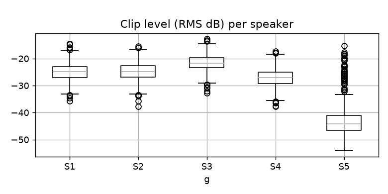
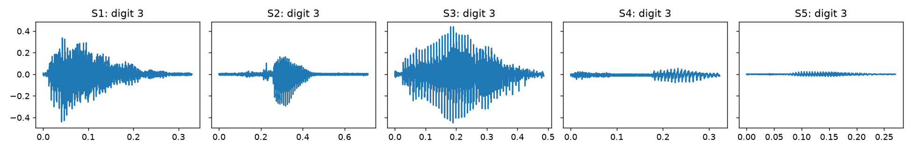
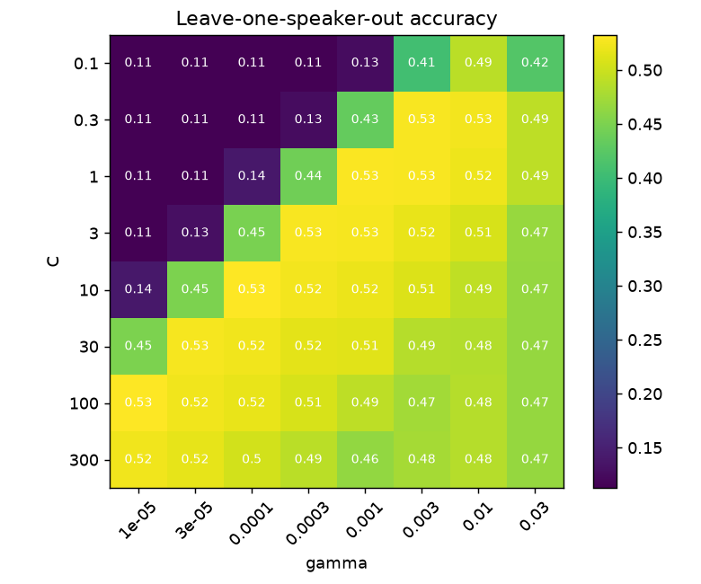
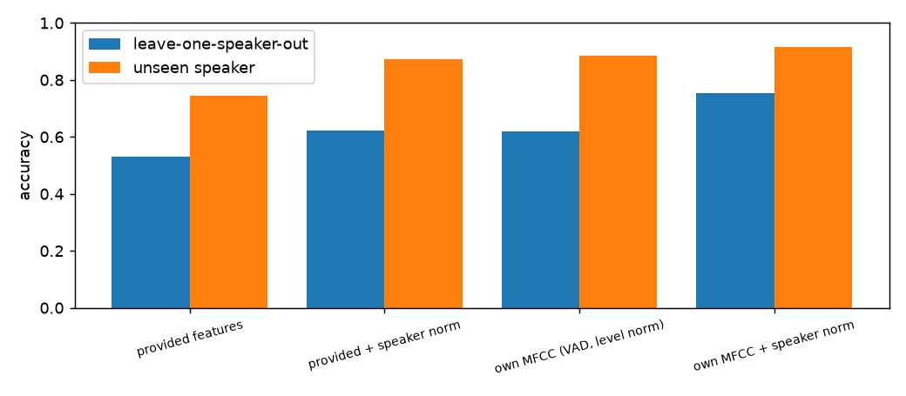
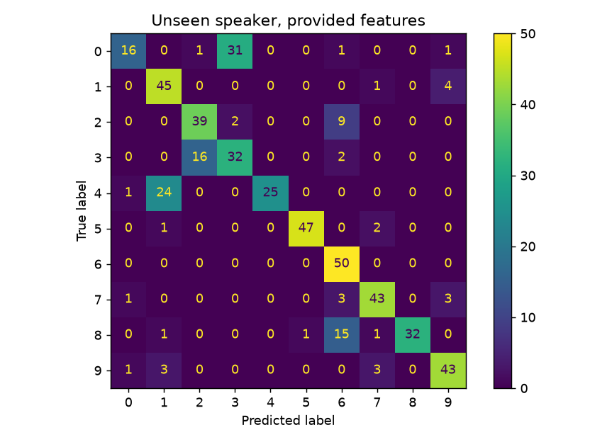
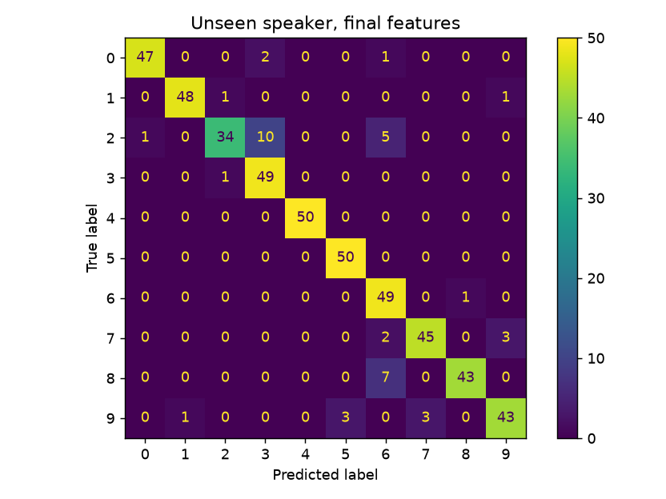

# Spoken digit recognition for unseen speakers (SVM + MFCC)

Recognise a spoken digit (0–9) from a short 8 kHz recording, **for a speaker the model has never heard**.
Most of the work went into making the evaluation honest and the features speaker-independent. The model itself is a plain RBF SVM.

| | accuracy on a new speaker |
|---|---|
| Baseline: RBF SVM on the 53 given features | 0.744 |
| **Final: own MFCC pipeline + per-speaker normalisation** | **0.916** |
| Leave-one-speaker-out estimate (4 speakers) | 0.532 → **0.754** |

## Key findings

**1. Standard K-fold badly overestimates accuracy.** Here is the same SVM scored three ways:

| estimate | accuracy |
|---|---|
| Stratified 5-fold (speakers mixed across folds) | 0.902 |
| Leave-one-speaker-out | 0.508 |
| A truly new speaker (S5) | 0.730 |

Stratified K-fold lets the model hear the test speaker during training, so it measures "known speaker" accuracy.
All model selection here therefore uses **leave-one-speaker-out (LOSO)** cross-validation.

**2. The recordings differ more by speaker than by digit.** The new speaker is ~20 dB quieter than everyone in training.
One training speaker has a DC offset, some clips are clipped, and some are padded with long silence.
Two of the given features turned out to be log-energy and clip duration, which track the recording rather than the digit.




**3. Scaling matters a lot for an RBF kernel.** K(x, x′) = exp(−γ‖x − x′‖²), and the feature spreads differ by about 290×.
Without standardisation, a few large features dominate the distance: LOSO accuracy is 0.297 unscaled and 0.508 scaled.



**4. Some training labels are wrong.** I listened to the 5 clips the model rejects most confidently, and all 5 say a different digit from their label.
This is why the final model uses a moderate C (1.0, the smallest C on the accuracy plateau) instead of a large one that would fit the noise.

## Feature pipeline (`src/features.py`)

```
wav ─► remove DC ─► peak-normalise ─► pre-emphasis ─► 32 ms Hamming frames (10 ms hop)
    ─► energy VAD: keep first..last frame within 35 dB of the loudest
    ─► 26-band mel filterbank ─► log ─► DCT ─► 13 MFCCs
    ─► [mean, std, delta-std, mean of 5 time segments]  (91 features)
    ─► z-score each feature within each speaker
```

- **Level and DC normalisation** remove microphone gain differences.
- **VAD** removes silence and padding, so clip length stops leaking into the features.
- **5 time segments** keep the coarse time shape of the word. "Six" and "seven" differ in order, not only in average spectrum.
- **Per-speaker z-scoring**, similar to cepstral mean/variance normalisation, removes each speaker's average vocal-tract and channel colouring. It uses only the rows of the file it is given, so it also works on a new file of an unseen speaker.

### Ablation

| features | LOSO | worst speaker | new speaker |
|---|---|---|---|
| given features | 0.532 | 0.448 | 0.744 |
| given + speaker norm | 0.622 | 0.596 | 0.874 |
| own MFCC (VAD, level norm) | 0.620 | 0.530 | 0.884 |
| **own MFCC + speaker norm** | **0.754** | **0.702** | **0.916** |



## Error analysis
I listened to 8 misclassified clips from the new speaker. Five were very quiet recordings, one had background noise, one had trailing silence and one had an unusual voice.
Most confusions are between similar-sounding words: 4 → 1 ("four" / "one") and 0 → 3 ("zero" / "three").

| baseline | final |
|---|---|
|  |  |

## Limitations and next steps
- LOSO trains on only 3 speakers, so 0.75 is a cautious estimate. The single new speaker (0.92) is an optimistic one.
- Reverberation or coloured noise from a different room or microphone would smear the time segments and break the fixed 35 dB VAD.
  Next things to try: noise and reverberation augmentation, or a noise-adaptive VAD threshold.

## Run it

```bash
pip install -r requirements.txt
python src/experiments.py --data data    # all figures + results/metrics.json (~15 s)
python src/predict.py --data data --test data/partA_val.csv --out predictions.csv
```

Expected data layout (not included in this repo):

```
data/
  partA_train.csv   # clip_id, f1..f53, g (speaker), y (digit)  – speakers S1–S4
  partA_val.csv     # same columns – speaker S5
  audio/<clip_id>.wav
```

## Project structure

```
src/features.py      audio loading, audio statistics, MFCC + VAD, speaker normalisation
src/model.py         final SVM and hyperparameters
src/experiments.py   EDA, validation comparison, C/γ search, error analysis, ablation
src/predict.py       train the final model and predict a new file
results/             figures and metrics.json
```

Built with NumPy, SciPy and scikit-learn. The MFCCs are implemented from scratch, without an audio library.
